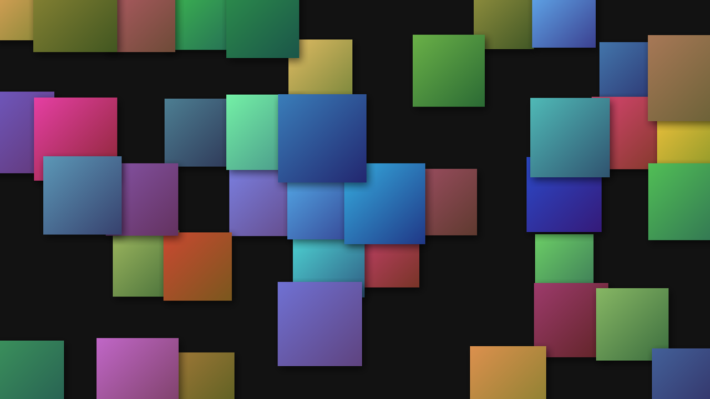

# Spotify Wallpaper

Turns the song covers of your Spotify playlists into a desktop wallpaper at your monitor resolution.

Before the image is built, a small window shows you every cover: approve it with a priority (1–5) or leave it out. The program then lays out the collage, loosely stacked with shadows.


**Too few covers?** At the end, the program asks whether to repeat covers (like above) or to leave gaps:



<sub>The example images use colored placeholders instead of real album covers.</sub>

Built for Spotify. *Not affiliated with or endorsed by Spotify.*

## TL;DR

1. `pip install requests pillow spotipy`
2. Create an app in the [Spotify Developer Dashboard](https://developer.spotify.com/dashboard) with the redirect URI `http://127.0.0.1:8888/callback` and tick **Web API**.
3. Copy `config.example.json` to `config.json` and fill in the client ID, the client secret and your playlist link.
4. `python spotify_collage.py`, log in once in the browser, rate the covers, done: `wallpaper.png`.

## Contents

1. [Requirements](#1-requirements)
2. [Create a Spotify developer app](#2-create-a-spotify-developer-app)
3. [Fill in config.json](#3-fill-in-configjson)
4. [Run it](#4-run-it)
5. [All settings](#5-all-settings)
6. [Folder layout: what goes where?](#6-folder-layout-what-goes-where)
7. [Troubleshooting](#7-troubleshooting)

---

## 1. Requirements

- **The ability to read** https://www.google.com/search?q=how+to+read
- **Python** with `requests`, `pillow` (image processing) and `spotipy` (Spotify login): `pip install requests pillow spotipy`
- **A Spotify account.** You use it in the next step to create a free developer app.

The program is built for **Windows**. It also runs on macOS and Linux, but automatic detection of the monitor resolution is less accurate there. In that case it's best to set the resolution in `config.json`.


## 2. Create a Spotify developer app

Spotify only hands out playlist data to registered apps. You create the app once.

1. Open the **[Spotify Developer Dashboard](https://developer.spotify.com/dashboard)** and log in with your normal Spotify account.
2. Click **“Create app”**.
3. Fill in the form:

   | Field | What to enter |
   |---|---|
   | **App name** | anything (Spotify doesn't allow the word “Spotify” in it) |
   | **App description** | anything |
   | **Website** | leave empty |
   | **Redirect URIs** | enter exactly `http://127.0.0.1:8888/callback` and click **“Add”** |
   | **Which API/SDKs are you planning to use?** | tick **Web API** |

   The redirect URI has to be **exactly** this: `127.0.0.1`, not `localhost`, and no `/` at the end. Otherwise the login fails.

4. Tick the terms of use and click **“Save”**.
5. In your app, click **“Settings”**. There you'll find:
   - the **Client ID**, which you can copy directly,
   - the **Client secret**, behind **“View client secret”**.

   You need both values in the next step.

 **Treat the client secret like a password.** Don't share it, don't post it anywhere and don't upload it. That's why `config.json` is listed in `.gitignore`.

## 3. Fill in config.json

1. Copy `config.example.json` and name the copy **`config.json`**. It has to be in the same folder as `spotify_collage.py`.
2. Open `config.json` in a text editor such as Notepad or VS Code and enter your values: the client ID and client secret from step 2, and under `playlists` your playlist link (in Spotify: **⋯ → Share → Copy link to playlist**).

Works with your own and other public playlists, albums and tracks, but not with playlists generated by Spotify (Discover Weekly, Daily Mix …).

## 4. Run it

```bash
python spotify_collage.py
```

On the **first run**, **your browser opens** with the Spotify login. Log in and click “Agree”. You then land on a page that doesn't load (`127.0.0.1:8888/...`). That's normal: the program still received the login, and you can close the tab.

Then, on every run:
1. The covers are downloaded.
2. **The rating window** shows each cover one by one:

   | Key | Effect |
   |---|---|
   | `1` – `5` | use the cover with this priority (5 = important) |
   | `0` or `N` | don't use the cover |
   | `←` / Backspace | back to the previous cover |
   | `Esc` | done; covers not rated yet are left out |

   Nothing is saved: every run asks about all covers again.
3. If there are **too few covers** for your resolution, a pop-up asks what to do: **Yes** = repeat covers, **No** = leave gaps, **Cancel** = don't create anything.
4. Done. The image is saved as `wallpaper.png` in the project folder.

## 5. All settings

### In `config.json`

| Entry | Possible values | Meaning |
|---|---|---|
| `spotify_client_id` | text | Client ID of your Spotify app |
| `spotify_client_secret` | text | Client secret of your Spotify app |
| `playlists` | list of links | playlists, albums or tracks whose covers are used |
| `resolution` | `"auto"` or e.g. `"2560x1440"` | size of the image. `auto` detects the main monitor. |
| `rotation` | number (degrees), e.g. `6` | maximum random tilt of the covers. `0` = straight. |
| `output` | file name | where the image is saved |

### On the command line

| Option | Meaning |
|---|---|
| `links ...` | Spotify links instead of `playlists` from the config |


## 6. Folder layout: what goes where?

```
Spotify_Wallpaper/
├── spotify_collage.py      ← the program
├── config.example.json     ← template (don't edit)
├── config.json             ← YOUR settings and credentials        (not in Git)
├── README.md
├── docs/                   ← example images for the README
├── wallpaper.png           ← the finished image                    (not in Git)
└── .spotify_cache          ← saved Spotify login                   (not in Git)
```

The `output` path in `config.json` is always relative to the program folder, so it doesn't matter which folder you start the program from.

**Starting over:** delete `.spotify_cache` and you have to log in to Spotify again, for example with a different account.

## 7. Troubleshooting

Errors show up as a pop-up and in the terminal.

| Problem | Fix |
|---|---|
| `can't open file '...spotify_collage.py'` | You're in the wrong folder. `cd` into the project folder first. |
| “Some Python packages are missing” | Run `pip install requests pillow spotipy`. |
| “Spotify credentials are missing” | Enter the client ID and secret in `config.json` (step 3). |
| Browser shows **INVALID_CLIENT** | The client ID is wrong, check it in `config.json`. Then stop the program in the terminal with `Ctrl+C` and start it again. |
| Browser shows **INVALID_CLIENT: Invalid redirect URI** | The redirect URI in your Spotify app must be exactly `http://127.0.0.1:8888/callback`. |
| “Spotify login failed” | Check the client secret. For someone else's Spotify account, add that account under “User Management”. |
| “These links could not be fetched” | Playlists made by Spotify, such as “Discover Weekly”, “Daily Mix” or “Release Radar”, are blocked for the API. Fix: in Spotify, select all songs (`Ctrl+A`) and copy them into a playlist of **your own**. |
| “config.json is not valid” | There's a typo in the JSON. See the line and column in the pop-up. |
| Image has the wrong size | Set `"resolution"` explicitly, e.g. `"2560x1440"`. |
